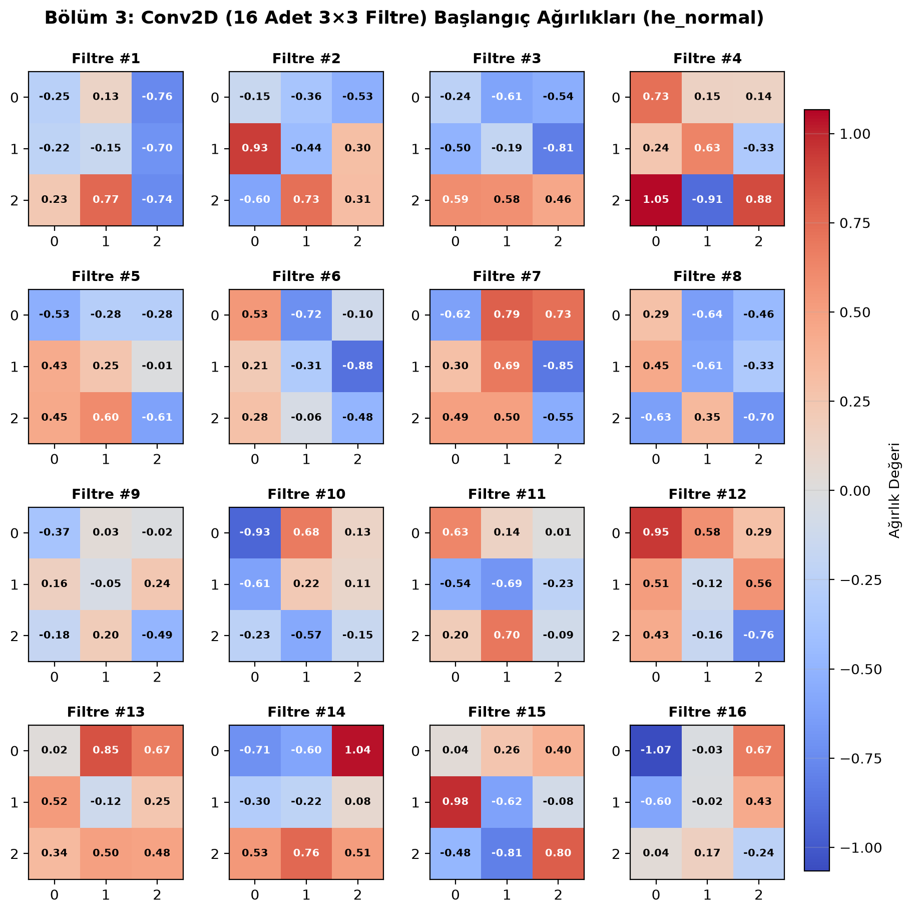
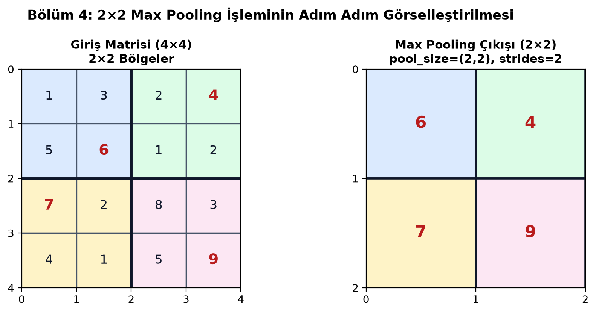
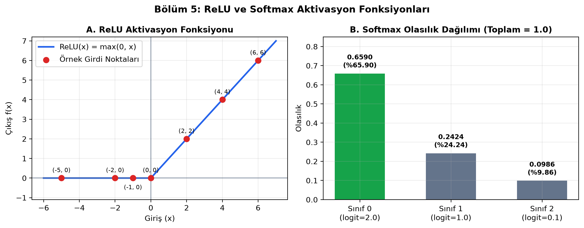
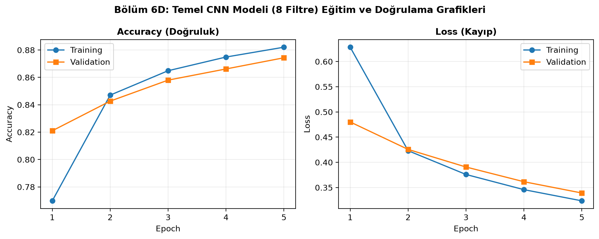
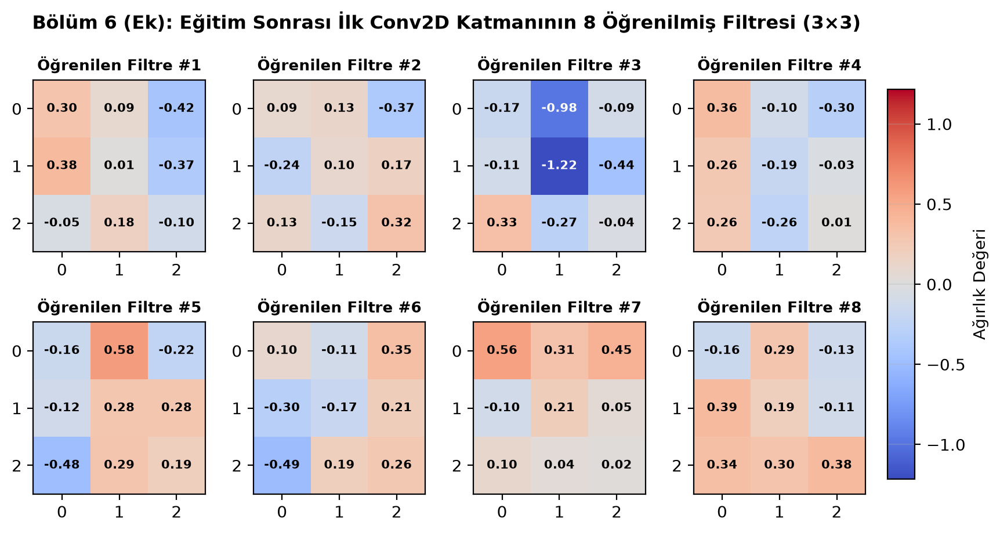
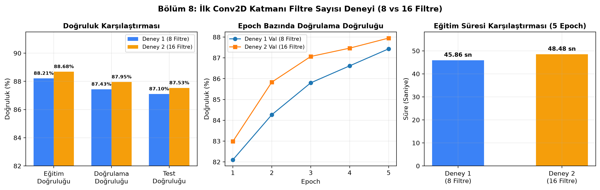

# Derin Öğrenme ve Evrişimsel Sinir Ağlarının (CNN) Temel Yapısının İncelenmesi

- **Öğrenci:** Melike Yetmen (`02230224059`)
- **Bölüm / Sınıf:** Yazılım Mühendisliği — 4. Sınıf
- **Ders:** Bilgisayar Görmesi / YMG-3
- **Teknolojiler:** Python 3.12, TensorFlow `2.21.0` / Keras, NumPy, Matplotlib
- **Veri Seti:** Fashion-MNIST (`60.000` eğitim + `10.000` test, `28×28×1`)

---

## 📁 Teslim Edilen Dosyalar
| Dosya | Açıklama |
|---|---|
| [`derin_ogrenme_odevi.ipynb`](derin_ogrenme_odevi.ipynb) | Tüm teorik cevapları, çalıştırılmış kod hücrelerini ve grafikleri içeren Jupyter defteri |
| [`derin_ogrenme_odevi.py`](derin_ogrenme_odevi.py) | Tüm bölümleri çalıştırıp grafik ve JSON çıktıları üreten Python uygulaması |
| [`Derin_Ogrenme_Odevi_Rapor.docx`](Derin_Ogrenme_Odevi_Rapor.docx) | Tüm teorik cevaplar, görseller, test sonuçları ve değerlendirme bölümü içeren Word raporu |
| [`Derin_Ogrenme_Odevi_Sunum.pptx`](Derin_Ogrenme_Odevi_Sunum.pptx) | Derste sunum için hazırlanmış PowerPoint sunumu (konuşmacı notlarıyla) |
| [`outputs/`](outputs/) | Yüksek çözünürlüklü deney grafikleri, filtre görselleştirmeleri, `deney_karsilastirma_tablosu.csv` ve `results.json` |

---

## 📊 Uygulama Çıktılarından Özetler

### Bölüm 3: Konvolüsyon Katmanı (`Conv2D`) ve 16 Filtre
- **Giriş Boyutu:** `(1, 128, 128, 1)` → **Çıkış Boyutu:** `(1, 126, 126, 16)`
- **Ağırlık Boyutu (`weights`):** `(3, 3, 1, 16)` (`144` ağırlık) | **Bias:** `(16,)` (`16` bias)



### Bölüm 4: `MaxPooling2D(pool_size=(2, 2), strides=2)`
- **Giriş (`4×4`):** `[[1.0, 3.0, 2.0, 4.0], [5.0, 6.0, 1.0, 2.0], [7.0, 2.0, 8.0, 3.0], [4.0, 1.0, 5.0, 9.0]]`
- **Çıkış (`2×2`):** `[[6.0, 4.0], [7.0, 9.0]]` *(Elle hesaplanan değerlerle birebir eşleşmiştir)*



### Bölüm 5: ReLU ve Softmax
- **ReLU Çıkışı:** `[-5.0, -2.0, -1.0, 0.0, 2.0, 4.0, 6.0]` → `[0.0, 0.0, 0.0, 0.0, 2.0, 4.0, 6.0]`
- **Softmax Olasılıkları:** `[0.659001, 0.242433, 0.098566]` (Toplam = `0.9999999403953552`)



### Bölüm 6: Fashion-MNIST CNN Eğitim & Test Sonuçları (8 Filtre)
- **Model Mimarisi:** `Input(28,28,1) → Conv2D(8, 3×3) → MaxPool(2×2) → Conv2D(16, 3×3) → MaxPool(2×2) → Flatten(400) → Dense(64) → Dense(10, softmax)`
- **Test Loss:** `0.3608` | **Test Accuracy:** `%87.10`





### Bölüm 8: Filtre Sayısı Deneyi (8 vs 16 Filtre)

| Ölçüt | Deney 1 (8 Filtre) | Deney 2 (16 Filtre) |
|---|---:|---:|
| İlk Conv2D Filtre Sayısı | `8` | `16` |
| Toplam Parametre Sayısı | `27,562` | `28,794` |
| Eğitim Doğruluğu (Epoch 5) | `%88.21` | `%88.68` |
| Test Doğruluğu (`10.000` örnek) | `%87.10` | `%87.53` |
| Eğitim Süresi (5 Epoch) | `45.86 sn` | `48.48 sn` |



---

## ▶️ Yerel Olarak Çalıştırma
```bash
pip install -r requirements.txt
python derin_ogrenme_odevi.py
```
